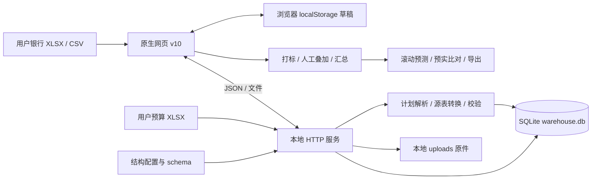
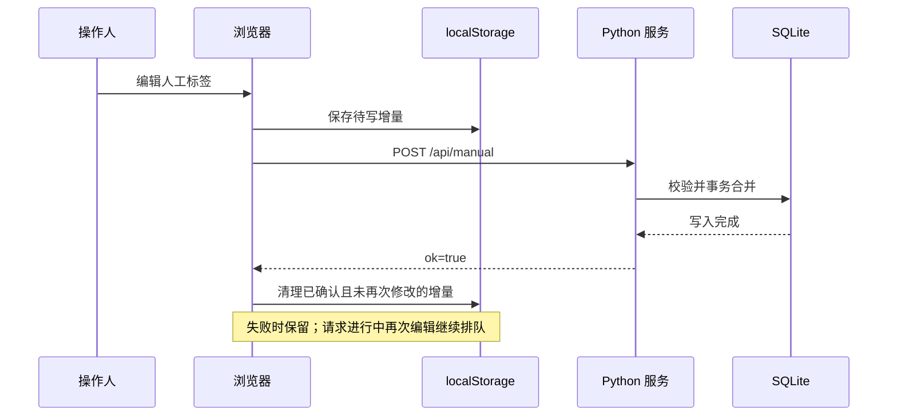

# 系统架构

应用采用本地网页加 Python 服务的结构。SQLite 保存原始行、人工结果和审批状态；浏览器执行流水规则、汇总、预测与比对。文件解析分为浏览器流水解析与后端计划解析两条路径。

## 保存链路

人工确认以业务键写入 `dwd_manual`。浏览器先保留草稿和待写增量，串行发送到 `/api/manual`；只有收到成功确认才清理已发送且未再改变的内容。刷新时，服务器结果与本地待写修改合并，待写内容优先。连接失败会保留修改并重试，避免假成功。

存档编辑通过 `/api/flow-edit` 将原始行、标签迁移和修改日志组合处理。规则按整组保存；参数和账期使用各自草稿，成功后清理确认的快照。localStorage 依赖浏览器与端口，不能替代数据库备份；多人同时修改同一条记录仍可能最后写入覆盖。

## 计划与计算

计划上传保存原件，再解析为 `plan_submission`、`plan_item` 和附页。批准后同步 `dwd_plan` 供旧看板消费；生态比对直接读取已锁定/已核销的计划明细。原始流水与人工标签在页面重算得到分类结果，`dwd_flow_tagged` 可保存分类快照。

滚动预测以有效计划为输入，根据回款比例和账期移动金额，再以预测起始月上月的实际余额作为期初。缺余额时不输出资金安全结论。

## 部署边界

服务只监听回环地址。没有账号认证、租户隔离、TLS、后台调度或生产并发控制。部分多步骤审批/同步使用多次数据库写入，尚未形成整个业务动作的单一事务。当前适合本地单人操作；扩展为多人服务需要另行设计权限、事务、冲突处理和部署结构。
