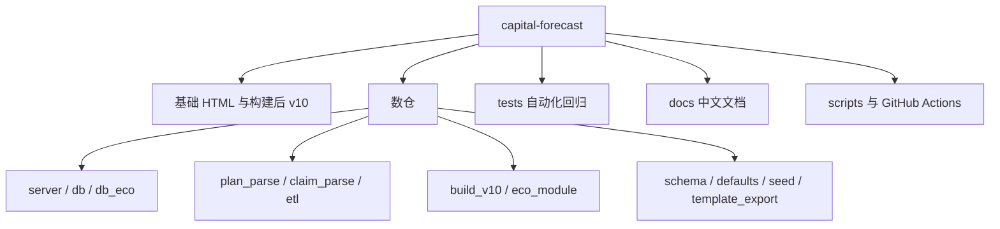

# 项目概况

- 类型：本地资金预测和计划管理应用，单进程 HTTP 服务，SQLite 本地文件存储。
- 语言：Python、JavaScript、HTML/CSS、SQL、PowerShell/Batch；文档为中文 Markdown/Mermaid。
- 服务入口：`数仓/server.py`；默认地址 `127.0.0.1:8765`。
- 页面入口：`生态资金计划系统v10.html`；源文件为 v9 HTML 与 `数仓/eco_module.js`。
- 基础配置：`数仓/defaults.json`，只包含科目、桥接、通用参数及人民币，不包含主体、客户或交易。
- 发布位置：GitHub `yandy-gif/capital-forecast`。公开仓库仅发布程序与文档，数据在各使用者本地生成。

