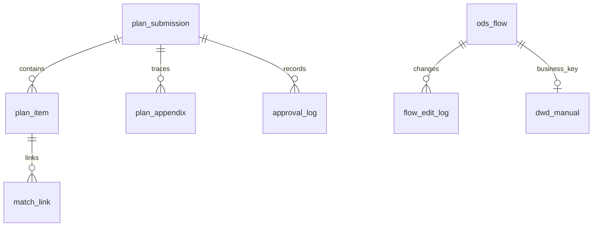

# 数据模型

正式存储为 `数仓/warehouse.db`，连接模式为 SQLite WAL。定义以 `数仓/schema.sql` 为准；`import_request`、`flow_edit_log` 目前由 `db.py` 按需创建。

| 表 | 用途与关键关联 |
| --- | --- |
| `ods_flow` | 原始流水 JSON、文件、批次、行序号；数据库行 id 用于存档编辑 |
| `dwd_manual` | 以 `uniq_key` 保存人工一级/二级/现金流分类及键组成字段 |
| `dwd_rule` | 规则集 JSON payload 与更新时间 |
| `dwd_flow_tagged` | 已分类流水快照；前端仍可从原始行与规则重算 |
| `dwd_plan` | 旧看板使用的计划投影，批准后的有效计划同步至此 |
| `meta` | 活跃批次等元数据 |
| `import_log`、`import_request` | 导入记录、申请确认与状态 |
| `flow_edit_log` | 流水字段、标签修改与原因留痕 |
| `tpl_registry` | 模板编号、版本、用途、路径和下载次数 |
| `subject_dict` | 方向/大类/科目/现金流属性 |
| `entity_ledger` | 主体、业务板块、币种、银行账户、合并/归集、负责人 |
| `fx_rate` | 币种到人民币汇率；可被 `biz_param` 中 fx 项覆盖 |
| `biz_param` | 参数 id、分组、值、单位、范围、说明与锁定标记 |
| `cust_term` | 客户名称、分类、账期天数、备注 |
| `flow_bridge` | 流水方向和标签到计划科目的映射与处理方式 |
| `plan_submission` | 期间、主体、版本、状态、金额汇总、校验报告、操作人时间与替换关系；`file_sha` 存上传文件 SHA256 用于文件级查重 |
| `plan_item` | 关联 `sub_id`；方向、科目、原币/人民币金额、时点、责任人、源行 |
| `plan_appendix` | 关联 `sub_id`；销售回款/费用附页、客户商品/部门、数量单价扣率、源行 |
| `approval_log` | 关联 `sub_id`；动作、前后状态、原因、操作人、金额、闸门信息 |
| `match_link` | 计划明细与流水业务键的人工匹配关系 |

图中为逻辑关联，不代表所有关系都由数据库外键约束。当前审批同步及部分多表写入尚未整体事务化。

人工确认业务键采用「日期|金额|对方户名」，金额去除千位分隔符/币符并统一格式。这个键不是银行流水唯一编号；同日同金额同对手的真实多笔交易可能共享标签，需要业务核对。编辑键组成字段时 `edit_flow` 负责搬迁标签；原始行 id 与业务键的职责不同。

原文件保存在 `数仓/uploads/`，SQLite 中存文件引用。浏览器 localStorage 存 `pryan.*`、生态配置草稿等本地状态，不上传 GitHub，也不随数据库备份自动迁移。不同浏览器、端口具有不同的草稿空间。
