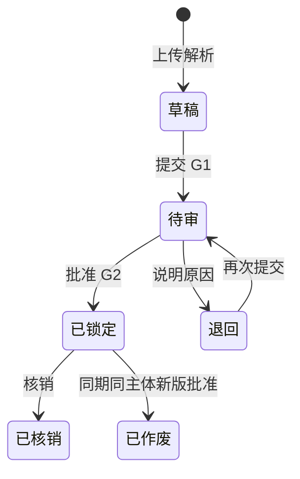
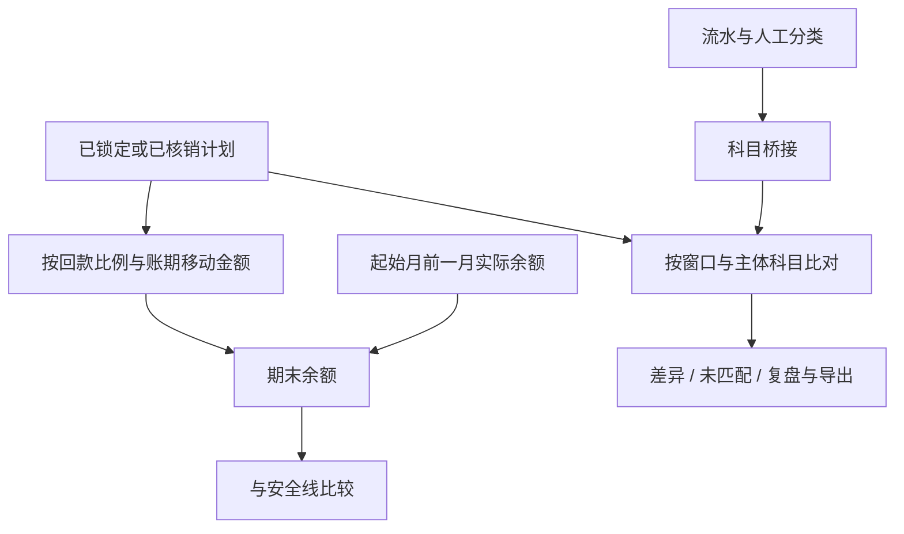

# 业务工作流

## 流水与人工确认

选择流水文件 → 检查表头/列映射/预览 → 导入 SQLite → 按规则分类 → 人工补充未命中或修正误分类 → 确认保存成功 → 管理分析/预实比对。来源、批次及修改历史可回查。刷新不是删除操作，尚未确认成功的草稿保存在本浏览器，恢复连接后继续保存。

## 计划提报与审批

「发起变更」另外复制一份新版本草稿，旧版仍保持已锁定，直到新版批准才替换旧锁定版。批准后将有效明细同步至旧看板计划表；核销记录保留参与取数。

上传标准表时，后端读取预算明细与附带字典；原币乘汇率重算人民币金额，文件原金额差异产生提示。G1/G2/G3 是校验报告分组，不能据此推断有三级审批。实际拦截与强制放行规则见 [功能清单](features.md)。

源表转换遵循 C-01 至 C-09：销售按数量×售价×扣率，KA 进入主表，非 KA 写排除附页；特定缺扣率从客户主数据补齐，其余列入待补；部门/人力预算按语义映射科目，不推算缺失工资；按客户/科目汇总并保留附页；科目必须在字典内。发布版不默认猜测公司主体。

## 预测与比对

预测起始月取最新有效计划期间；余款按客户账期或默认账期后移，采购按付款账期移动。缺期初余额时仍可显示净流，但不输出安全结论。预实分析的同期、账期、滚动窗口属于分析口径，不改变原流水日期和已批准计划。
